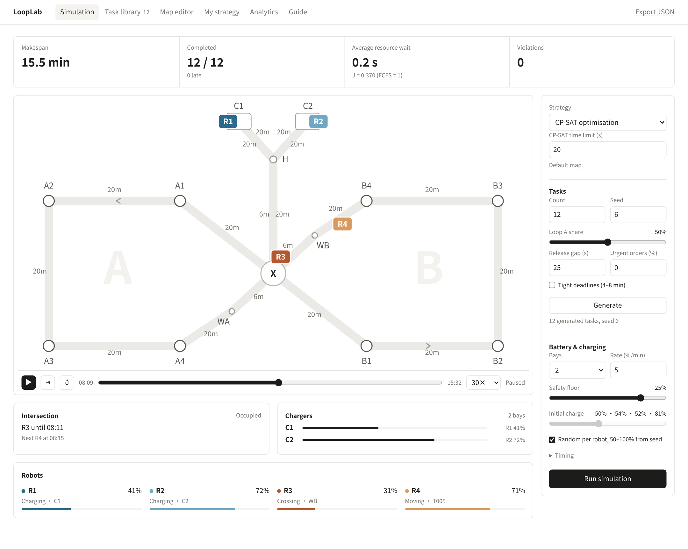
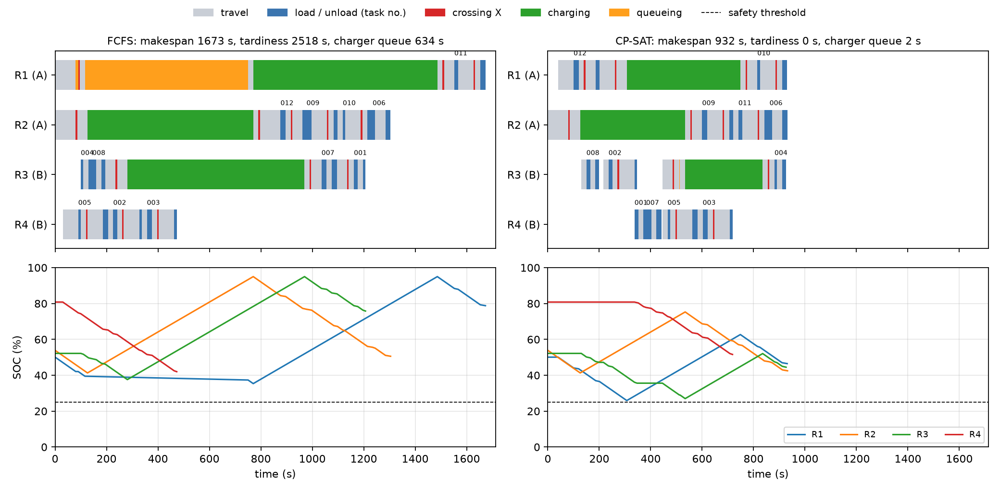
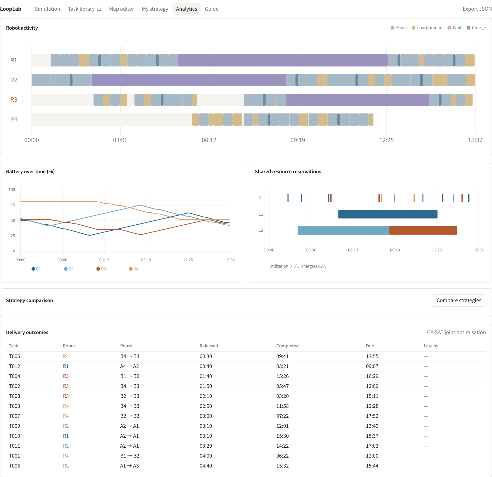
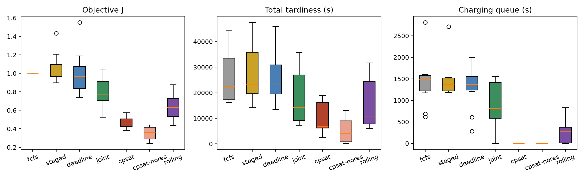
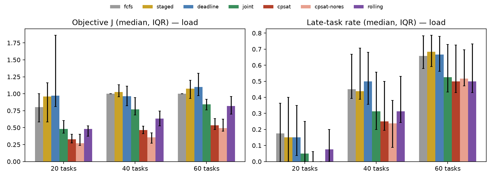

# Joint Scheduling of Intersection Access and Shared Charging Resources for Delivery Robots in a Dual-Loop Network

EE6228 course project (topics M02 + M04). Pure-software 2-D online simulation.

## 1. Case introduction

Two delivery zones, A and B, are each served by a closed one-way loop. The loops meet at a single
mutually exclusive intersection X, and both zones share one charging area (entrance H, bays C1 and C2)
that can only be reached through X. Four virtual robots work in the network: R1 and R2 serve zone A,
R3 and R4 serve zone B. Pick-up-and-delivery orders arrive over time, each with a release time,
pick-up station, drop-off station, handling times, a due time and a priority.

The two shared resources are coupled. A robot that needs to charge must cross X twice (out and back),
so intersection congestion delays charging; a charging queue in turn shifts every later intersection
request of that robot and of the robots behind it. Batteries make the problem harder still: a robot may
only accept an order if, after completing it, it can still reach a charger without falling below the
safety threshold. The project studies how to coordinate **task assignment, task order, intersection
time slots, charger choice and charging duration** so that the fleet stays safe and on time under
high load.

Scope: self-designed map and data; robots move along fixed directed routes (no continuous kinematics
or obstacle avoidance); battery, handling and charging are software states. The emphasis is on
scheduling and resource conflicts.

### 1.1 Related work

Scheduling, routing and control of automated guided vehicles (AGVs) have been surveyed extensively [9–13]. The surveys contrast dispatching rules, which decide one vehicle or one order at a time, with optimisation approaches that decide assignment, sequencing and conflict-free timing together; our baselines belong to the first group, CP-SAT to the second. Large warehouse fleets combine central allocation of orders and resources with path planning by the individual robots [14], and multi-agent path finding formalises collision-free movement on a graph [15]. Reserving an intersection in space–time, as our calendar for X does, was proposed for autonomous vehicles by Dresner and Stone [16]. Battery constraints matter in AGV simulation and planning [17, 18]; in electric vehicle routing, recharging stations [19], partial recharging [20] and non-linear charging curves [21] are modelled explicitly. The optimiser follows constraint-based scheduling with optional interval variables and no-overlap constraints [4, 5], solved by the CP-SAT solver of Google OR-Tools [1, 2], which builds on lazy clause generation [3] and uses large neighbourhood search [6] among its parallel workers. The online variant applies the rolling (receding) horizon principle [22, 23].

## 2. System description

### 2.1 Network

Each loop is the directed cycle $X \to Z_1 \to Z_2 \to Z_3 \to Z_4 \to W_Z \to X$ for
$Z \in \{A, B\}$. $W_A$ and $W_B$ are the only places where a robot may wait for the intersection.
Every edge that enters X ($W_A \to X$, $W_B \to X$, $H \to X$) is a *crossing*; X can hold at most
one robot, and two consecutive crossings must be separated by a safety buffer on each side.
The charging branch is $X \to H \to C_p \to H \to X$; robots queue at H, never inside X or an
occupied bay, and leave the bay as soon as charging ends.

Because a robot travels around its loop, every lap passes through X: the intersection is not only on
the way to the chargers but on every delivery whose drop-off lies "behind" its pick-up, and on every
empty repositioning that wraps around the loop.

### 2.2 Default parameters

| Parameter | Base setting | Tested range |
|---|---|---|
| Robots | 4 (2 per loop) | — |
| Orders | 40 | 20, 40, 60 |
| Initial SOC | uniform 50–100 % per robot (seeded) | — |
| Safety threshold | 10 % | 10, 20, 30 % |
| Ordinary edge | 20 m, 20 s, 2 % | editable lengths |
| Crossing into X | 6 s | 5–8 s |
| Safety buffer | 2 s each side (4 s between crossings) | 1–4 s |
| Waiting drain | 0.2 %/min | 0–0.5 %/min |
| Load / unload | 10–20 s each, 0.5 % each | — |
| Charging | linear, 5 %/min | 3–8 %/min |
| Charging bays | 2 | 1, 2 |
| Due time | release + 8–15 min (tight: 4–8 min) | — |
| Priority | 1 (50 %), 2, 3 | urgent orders 4–5 |
| Zone A share | 50 % | 1:1, 2:1, 3:1 |
| Urgent orders | 0 | +10 %, +20 % (due in 3–6 min) |

Orders are released uniformly over $[0, 12n)$ seconds for $n$ orders. The generator is seeded, and
urgent orders and initial SOC come from separate random streams, so adding urgent orders never changes
the base workload of the same seed. All strategies are evaluated on the identical instance.

### 2.3 Objective

The proposal's objective adds terms with different units: seconds of makespan, seconds of
priority-weighted lateness, seconds of queueing and percentage points of energy. Under load the
lateness term reaches tens of thousands of seconds and would swamp everything else. Each term is
therefore normalised by its value in the FCFS schedule of the same instance and the four normalised
terms are weighted equally:

$$J = \tfrac14\left(\frac{C_{\max}}{\hat R_C} + \frac{\sum_i p_i T_i}{\hat R_T}
+ \frac{W_{\text{cross}} + W_{\text{charge}}}{\hat R_W} + \frac{E}{\hat R_E}\right),
\qquad T_i = \max(0, C_i - d_i),\quad \hat R_k = \max(R_k^{\text{FCFS}}, f_k)$$

where $C_{\max}$ is the completion time of the last order (s), $p_i$ the priority, $T_i$ the
tardiness (s), $W$ the total intersection and charger queueing time (s) and $E$ the total energy
consumed (% SOC). The floors $f = (1\,\text{s}, 60\,\text{s}, 60\,\text{s}, 1\,\%)$ only matter when
FCFS has (almost) no lateness or queueing. FCFS therefore scores $J = 1$ (slightly less when one of
its terms is below the floor), and $J = 0.6$ reads as "40 % better than FCFS on this weighted
balance". Battery safety is **not** traded off: falling below the safety threshold is a hard
constraint, checked by an independent validator, so $N_{\text{unsafe}} = 0$ in every reported
schedule.

## 3. Simulator

The simulator is a dependency-free Python web application (standard-library HTTP server, SVG front
end). Its core is a deterministic discrete-event engine with reservation calendars:

- **World and energy model** (`simulator.py`, `customization.py`): directed edges with length,
  travel time and energy; per-action SOC updates for moving, crossing, waiting, handling and charging.
- **Reservation calendars**: one for X (with the $2 \times$ buffer gap) and one per bay, in the spirit of reservation-based intersection management [16]. A robot
  requesting a resource receives the earliest feasible slot and the waiting time is recorded as an
  explicit `cross_wait` or `charge_wait` action at an allowed waiting point.
- **Independent validator** (`validate_result`): recomputes from the returned action log alone the
  energy of every action, edge legality, route continuity, pickup-before-delivery, release times,
  action overlap per robot, exclusive and buffered resource use, waiting locations, immediate charger
  departure and SOC bounds. A schedule that fails validation is never returned as a result.
- **Replay and analytics** (`static/`): the 2-D animation reads only the event log (it never
  recomputes timing), plus a Gantt chart, battery curves, reservation timelines for X/C1/C2, a
  delivery table and a strategy comparison. Tasks, schedule, events, robots and summary export to CSV.
- **Command mode**: an external plan (robot, start time, action) can be executed strictly; timing,
  resource and battery conflicts are reported instead of being repaired.



*The running 2-D web application (regenerate with `report/capture_ui.py`). The map, robots, intersection state and bay occupancy are redrawn from the event log during replay; the right-hand panel holds the instance generator, battery and charging parameters and strategy selection.*

## 4. Scheduling strategies

### 4.1 Baselines

1. **FCFS** — orders in release order; each goes to the compatible robot with the earliest predicted
   completion; a robot below 20 % SOC charges before its next order; intersection slots are granted in
   booking order (first come, first served).
2. **Staged** — the proposal's "assign, then reserve the intersection, then charge" decomposition.
   Stage 1 assigns orders by list scheduling [7] on nominal travel times, ignoring X, chargers and
   battery. Stage 2 executes each robot's fixed sequence with intersection reservations. Stage 3
   inserts a charge only when the next order would otherwise be unsafe.
3. **Deadline + reservations** — earliest due date first [7, 8] (priority breaks ties), with the resource
   reservations and energy checks of the full engine.
4. **Joint greedy** — evaluates up to eight upcoming orders on both compatible robots, including the
   resulting intersection and charger reservations and charging insertions, and picks the candidate
   with the lowest score using the weights of $J$ (with the order's own completion time in place of
   $C_{\max}$).

All automatic strategies keep a battery reserve before accepting an order: the robot must be able to
finish it, reach H and survive the currently booked charger queue plus a conservative allowance for
the other three robots.

### 4.2 CP-SAT joint optimisation

The model is solved with CP-SAT (Google OR-Tools 9.15) [1, 2]. The full formulation is in `docs/optimizer_model.md`; this section summarises it. The key
observation is that routes are fixed, so for every pair of consecutive jobs of a robot the travel
time, energy and the **set of crossings of X** are known in advance. Each robot $k$ gets a graph whose
vertices are a depot (its current state), every order of its loop, and $|Q_k|$ optional charging
visits.

*Decision variables.* $x_{ik}$ assigns order $i$ to robot $k$; arc literals $a_{kab}$ choose the
successor of each vertex; $s_i, c_i$ are order start and completion; for each crossing $r$, the entry
time $e_{kr}$ and the wait $w_{kr}$ in front of X (exit $l_{kr} = e_{kr} + \tau_r$); for each charging
visit $q$ a presence literal, a bay literal $b_{kqp}$, the H queue $w^C_{kq}$, charging start $u_{kq}$
and duration $D_{kq}$ (and thus the charged amount); SOC after incoming travel and after service at
every vertex; tardiness $T_i$ and $C_{\max}$.

*Constraints.*

- **Assignment and order:** $\sum_k x_{ik} = 1$; one `AddCircuit` per robot, with self-loops for
  absent vertices, so each robot follows a single sequence starting at its depot.
- **Timing:** if arc $a \to b$ is chosen, $b$ starts after $a$ ends and its arrival follows the
  fixed path; $s_i \ge r_i$. Idle time between jobs costs no energy, as in the simulator.
- **Intersection:** every crossing on every arc and inside every order is an optional interval [4]
  $[e_{kr}, l_{kr} + 2\beta)$, present only if its arc is chosen. All of them share one `NoOverlap`,
  which enforces both mutual exclusion and the $2\beta$ buffer. The wait $w_{kr}$ happens at the
  incoming waiting point ($W_A$, $W_B$ or H), never inside X.
- **Chargers:** for the chosen bay $p$, the bay interval $[u_{kq}, u_{kq} + D_{kq})$ joins that bay's
  `NoOverlap`; the robot leaves the bay as soon as charging ends. SOC before charging must be
  $\ge S_{\min}$, and SOC after charging, $S^- + \rho_c D_{kq}$, must be $\le 100$. The charged amount
  is a decision, unlike the heuristics' fixed 95 % target.
- **Energy:** along every chosen path SOC decreases by the edge, handling and waiting consumption and
  must stay $\ge S_{\min}$ at every vertex; since SOC only decreases between charges, this checks
  every intermediate action.
- **Terminal reserve:** after its last order every robot that executes orders must keep enough energy to reach a bay even
  behind a full queue — the same reserve the heuristics enforce before accepting any order — and the
  decoded schedule is re-checked with the simulator's own reserve test.

Time is scaled to milliseconds and SOC to integer units, with every duration and consumption rounded
**up** so that integer-feasible schedules remain feasible in the exact simulator. The objective is
exactly the normalised $J$ of Section 2.3, whose references are constants computed before the solve.
The model is warm-started with the joint greedy schedule (`AddHint`).

*Decoding.* The solver's choices (sequence, crossing entry times, bay, charging start and target SOC)
are replayed through the simulator's own `Planner`, so times and energy in the returned schedule come
from the simulator, and the result must pass the independent validator. If the decoded schedule is
worse than the warm start or fails validation, the warm start is returned and the fallback is
recorded, so CP-SAT never reports a schedule worse than joint greedy.

*Search.* CP-SAT is run with 8 parallel workers. With a single worker, the solver did not improve the
warm start on 40-order instances even after about two minutes, while the parallel portfolio, whose
large-neighbourhood-search [6] workers do most of the work, improved it substantially within the same
time. On small instances (4–6 orders) the model reaches proven optimality and matches the analytical
lower bound (unit tests). On realistic sizes the lower bound stays weak (large reported gaps), so the
results are good incumbents, not proven optima.

### 4.3 Rolling-horizon re-optimisation

Offline optimisation assumes all orders are known at time 0. The rolling strategy removes that
assumption: an order becomes visible only at its release time, and the plan is recomputed over a receding horizon [22, 23].

```
t ← 0
while orders remain:
    known ← orders released by t and not yet started
    window ← known orders, most urgent first, until ≈ 600 s of work per loop
    plan ← CP-SAT on window from the robots' current states,
           with all already-committed X and bay reservations as fixed intervals
           (1 worker, deterministic budget ≈ 0.5 s; warm start = joint greedy on the window)
    commit every job of plan that starts before t + 60 s; freeze its reservations
    t ← t + 60 s
```

Committed actions are never revised. Each window solve additionally requires the last planned job
of every robot to leave enough energy to reach a charger even if the bays are busy, so that the next
window is never left in an energy dead end. Even the normalisation is online: at each re-plan the
references come from an FCFS schedule of only the orders known so far, continued from the robots'
current state. (An earlier version used full-instance references; the review showed that this
changed decisions, i.e. it leaked future information.) The final schedule is scored with the
full-instance $J$ like every other strategy.

## 5. Worked example

This section follows a single small instance in full. It has 12 orders (seed 6, with a release gap of 25 s instead of the default 12 s, so all are released during the first 280 s; five in zone A and seven in zone B), initial SOC 50.1, 53.9, 52.2 and 80.8 % for R1–R4 (the app's "random per robot" draw for this seed), a 25 % safety threshold and two bays; all other parameters are the defaults. FCFS is compared with CP-SAT, run with one worker and a deterministic budget so the schedule is reproducible. Both schedules pass the independent validator; `report/case_study.py` regenerates every number below.

**Order assignment.** An order can only go to one of the two robots of its zone, but the methods split them differently. FCFS gives T012 (due at 547 s) to R2, which first has to charge; T012 is completed only after R2's 11-minute charge, 430 s late. CP-SAT also sends R2 to charge first, but lets R1 serve T012 before charging itself (completed at 201 s). In zone B, R4 serves four orders, two of them while R3 is at the charger.

| Order | Loop: route | r_i | d_i | p_i | FCFS robot | FCFS C_i | FCFS T_i | CP-SAT robot | CP-SAT C_i | CP-SAT T_i |
|---|---|--:|--:|--:|---|--:|--:|---|--:|--:|
| T005 | B: B4→B3 | 30 | 835 | 2 | R4 | 206 | 0 | R4 | 582 | 0 |
| T012 | A: A4→A2 | 40 | 547 | 1 | R2 | 977 | 430 | R1 | 201 | 0 |
| T004 | B: B1→B2 | 100 | 989 | 3 | R3 | 145 | 0 | R3 | 926 | 0 |
| T002 | B: B4→B3 | 110 | 729 | 3 | R4 | 337 | 0 | R3 | 347 | 0 |
| T008 | B: B2→B3 | 130 | 911 | 1 | R3 | 195 | 0 | R3 | 200 | 0 |
| T003 | B: B4→B3 | 170 | 748 | 2 | R4 | 473 | 0 | R4 | 718 | 0 |
| T007 | B: B2→B3 | 180 | 1072 | 1 | R3 | 1096 | 24 | R4 | 442 | 0 |
| T009 | A: A2→A1 | 190 | 829 | 1 | R2 | 1098 | 269 | R2 | 721 | 0 |
| T010 | A: A2→A1 | 190 | 937 | 1 | R2 | 1234 | 297 | R1 | 931 | 0 |
| T011 | A: A2→A1 | 200 | 1023 | 2 | R1 | 1673 | 650 | R2 | 862 | 0 |
| T001 | B: B1→B2 | 240 | 720 | 1 | R3 | 1207 | 487 | R4 | 382 | 0 |
| T006 | A: A1→A3 | 280 | 944 | 3 | R2 | 1304 | 360 | R2 | 932 | 0 |

**Intersection.** Each crossing occupies X for 6 s; the next may start no earlier than 4 s (2β) after it ends. The tightest pair of the CP-SAT schedule meets this bound exactly: R3 leaves X at 491.6 s on its way to the charger and R4 enters at 495.6 s. FCFS has the only intersection wait in either schedule: R2 crosses at 80 s and R1, arriving at W_A at the same moment, waits 10 s (6 s crossing plus the 4 s gap). CP-SAT avoids it by sending R1 through X at 140 s.

| Robot | Loop | Orders | Entries into X (s), CP-SAT | Initial SOC | Min. SOC | Final SOC |
|---|---|--:|---|--:|--:|--:|
| R1 | A | 2 | 140, 261<sup>c</sup>, 769<sup>H</sup>, 885 | 50.1 | 25.9 | 46.5 |
| R2 | A | 3 | 80<sup>c</sup>, 554<sup>H</sup>, 680, 816 | 53.9 | 41.3 | 42.5 |
| R3 | B | 3 | 271, 486<sup>c</sup>, 855<sup>H</sup> | 52.2 | 27.0 | 44.5 |
| R4 | B | 4 | 496, 642 | 80.8 | 51.6 | 51.6 |

*Superscript c: on the way to the charger; H: returning from it; others: along the loop.*

**Charging.** Both methods charge three times, but very differently. FCFS always charges to 95 %. R2 takes C1 from 126 to 770 s. R1 reaches H at 116 s, but C2 is already booked for R3 from 281 s, and a full charge from 37 % needs about 12 minutes, so it fits in neither bay; R1 waits at H for 634 s and enters C1 at 770 s, the moment R2 leaves it. CP-SAT instead charges each robot only as far as its remaining orders and the terminal reserve require: R2 to 75.3 %, R1 to 62.7 %, R3 to 52.1 %. Total charging time falls from 2049 s to 1151 s, and the bays are chained without gaps. R3 reaches H at 512 s and waits there 2.4 s, then enters C2 at 534 s, exactly when R2 leaves it.

| Method | Robot | Bay | At H (s) | Queue (s) | Charging (s) | Duration (s) | SOC (%) |
|---|---|---|--:|--:|---|--:|---|
| FCFS | R2 | C1 | 106 | 0.0 | 126–770 | 644 | 41.3 → 95.0 |
| FCFS | R3 | C2 | 261 | 0.0 | 281–970 | 689 | 37.6 → 95.0 |
| FCFS | R1 | C1 | 116 | 634.4 | 770–1486 | 716 | 35.4 → 95.0 |
| CP-SAT | R2 | C2 | 106 | 0.0 | 126–534 | 408 | 41.3 → 75.3 |
| CP-SAT | R1 | C1 | 287 | 0.0 | 307–749 | 442 | 25.9 → 62.7 |
| CP-SAT | R3 | C2 | 512 | 2.4 | 534–835 | 301 | 27.0 → 52.1 |

**Battery.** Under FCFS, SOC rises in long ramps to 95 %, and R1's battery drains slowly while it waits at H. CP-SAT uses more of the available battery: R1 reaches its minimum of 25.9 %, 0.9 points above the threshold, on arrival at C1. All robots end between 42 and 52 %, at or above the terminal reserve. No robot falls below the threshold in either schedule.



**Outcome.** CP-SAT finishes all orders on time, 12 minutes earlier than FCFS, with 8 % less energy and practically no queueing.

| Metric | FCFS | CP-SAT |
|---|--:|--:|
| Makespan (s) | 1673 | 932 |
| Total tardiness (s) | 2518 | 0 |
| Late orders | 7 | 0 |
| Queueing at X / at H (s) | 10 / 634 | 0 / 2.4 |
| Energy consumed (%) | 160.5 | 147.8 |
| Charging sessions | 3 | 3 |
| Minimum SOC (%) | 35.4 | 25.9 |
| J | 1.000 | 0.370 |



## 6. Experiments

### 6.1 Setup

The experiment plan of the proposal is run by `experiments.py`. Every configuration uses seeds 1–10;
for a given seed all seven strategies (six plus the ablation of Section 7.2) receive the identical order list, configuration and seeded
initial SOC (50–100 % per robot), and the base setting is 40 orders, 2 bays, a 10 % safety threshold,
a 1:1 zone split and no urgent orders. One factor is varied per experiment:

| Experiment | Settings |
|---|---|
| Algorithm comparison | base |
| Load | 20, 40, 60 orders |
| Charging resources | 1 or 2 bays |
| Zone imbalance | A:B = 1:1, 2:1, 3:1 |
| Safety threshold | 10, 20, 30 % |
| Dynamic orders | +0, +10, +20 % urgent orders (due 3–6 min after release, priority 4–5) |

Identical instances that occur in several experiments (the base setting) are solved once, giving
10 distinct settings × 10 seeds × 7 strategies = 700 runs. Each run reports $J$, its four raw terms,
the late-order rate, queueing at X and at the chargers, energy, charging sessions and runtime. Because
the seeds differ strongly in difficulty, the tables also give the **paired** change of $J$ against
FCFS on the same instance.

*Compute.* The four heuristics and the rolling strategy are deterministic (rolling solves are bounded
by CP-SAT deterministic time, not wall time), so their results do not depend on the machine; this was
checked by reproducing a rolling run bit for bit on two different machines. CP-SAT is wall-time
bounded (120 s, 8 workers) and therefore hardware dependent; all CP-SAT runs used the same machine
type (Google Colab high-RAM CPU VMs, 8 vCPU Intel Xeon @ 2.20 GHz, OR-Tools 9.15), one solve per VM at
a time.

*Fairness caveats.* The heuristics and offline CP-SAT know the whole order list in advance (but never
start an order before its release); rolling is the only truly online method. All strategies end the
horizon with the same battery reserve (every robot that executes orders must still be able to reach
a charger behind a full queue; robots without orders never move in any strategy). A first run of
offline CP-SAT without that reserve, kept as the ablation `cpsat-nores`, often ended near the safety
floor and frequently skipped charging altogether (no charging at all on any 20-order instance), which
inflated its advantage; Section 7 quantifies this.
The heuristics also always charge to 95 %, whereas CP-SAT chooses the amount.

### 6.2 Algorithm comparison (base setting)

40 orders, 2 bays, 10 % threshold, 1:1 zones; mean over 10 seeds; paired change of $J$ against FCFS
as mean / median. Full tables: `results/results.md`; every run: `results/runs.csv`.

| Strategy | $J$ | vs FCFS | Late orders | Tardiness (s) | Makespan (s) | Charges | Energy (%) | Runtime ³ |
|---|---|---|---|---|---|---|---|---|
| FCFS | 1.000 | — | 52 % | 26 028 | 3 233 | 5.0 | 443 | < 0.1 s |
| Staged | 1.067 | +7 % / +2 % | 51 % | 27 264 | 3 441 | 5.4 | 449 | < 0.1 s |
| Deadline + reservations | 1.003 | 0 % / −4 % | 51 % | 25 994 | 3 210 | 4.9 | 438 | < 0.1 s |
| Joint greedy | 0.793 | −21 % / −23 % | 37 % | 17 826 | 3 021 | 3.9 | 386 | 0.3 s |
| Rolling CP-SAT (online) | 0.636 | −36 % / −37 % | 37 % | 15 651 | 2 741 | 4.3 | 389 | 49 s |
| **CP-SAT** | **0.468** | **−53 % / −54 %** | 33 % | 9 934 | 2 317 | 4.2 | 359 | 121 s |
| CP-SAT without reserve (ablation) | 0.349 | −65 % / −64 % | 23 % | 5 032 | 1 732 | 2.0 | 316 | 121 s |

³ Measured wall time per instance (the CP-SAT budget is 120 s; rolling on a 2-vCPU VM).



All 700 runs produced validated, energy-safe schedules; no strategy failed on any instance. Mean
and median give the same performance tiers, and these hold on most individual seeds (Figure above):
the three single-rule baselines stay within ±7 % of each other (their internal order differs: by
mean FCFS is marginally ahead of deadline-first, by median deadline-first is 4 % ahead), joint greedy
is about a fifth better, rolling about a third and offline CP-SAT about a half. Offline CP-SAT never
had to fall back to its warm start, but its optimality gap stays large (base setting: median 58 %,
range 51–70 %; all 100 instances: median 63 %, range 18–76 %):
the lower bound of the circuit model is weak, so these are good incumbents, not proven optima.

### 6.3 Sensitivity experiments

Median paired change of $J$ against FCFS. Means are in `results/results.md`; they differ strongly
where near-zero FCFS terms inflate individual runs (Section 7.3), e.g. at 20 orders staged +81 % and
deadline +134 % by mean against +7 % and +10 % by median.

| Experiment | Setting | Staged | Deadline | Joint | Rolling | CP-SAT |
|---|---|---|---|---|---|---|
| Load | 20 orders | +7 % | +10 % | −30 % | −43 % | −62 % |
| | 40 orders | +2 % | −4 % | −23 % | −37 % | −54 % |
| | 60 orders | +8 % | +10 % | −16 % | −18 % | −47 % |
| Chargers | 1 bay | +45 % | −1 % | −20 % | −28 % | −60 % |
| | 2 bays | +2 % | −4 % | −23 % | −37 % | −54 % |
| Imbalance A:B | 2:1 | +4 % | +2 % | −15 % ¹ | −25 % | −48 % |
| | 3:1 | 0 % | −6 % | −29 % | −30 % | −47 % |
| Safety threshold | 20 % | +2 % | +11 % | −18 % | −16 % | −51 % |
| | 30 % | +17 % | −1 % | −13 % | −16 % | −52 % |
| Urgent orders | +10 % | +1 % | −3 % | −12 % | −24 % | −52 % |
| | +20 % | +4 % | −5 % | −8 % | −20 % | −50 % |

¹ Mean +19 %: one seed scores $J = 3.7$ although joint beats FCFS on makespan, lateness and energy
there (Section 7.3).



- **Load.** Every method degrades as orders are added, but the gap to FCFS shrinks for the
  heuristics and for rolling (−43 % → −18 %) while CP-SAT keeps −47 % to −62 %. At 60 orders every
  method is late on more than half the orders (late rate 54–69 %); the fleet is simply over capacity,
  and charging (7–10 sessions of up to 17 min) is the binding resource.
- **One charging bay.** FCFS's charger queue grows from 1 437 s to 4 001 s, and the staged baseline
  collapses (+45 %): it decides charging last, so robots arrive at the single bay together. Joint
  greedy and CP-SAT, which decide charging together with the orders, hold their advantage; CP-SAT
  improves most (−60 %).
- **Zone imbalance.** With more work on loop A, makespan grows for all methods because R1/R2 become
  the bottleneck. The tiers are unchanged (CP-SAT, then rolling and joint greedy, then the
  single-rule baselines), although within the baseline tier deadline-first falls slightly behind
  FCFS by median at 2:1 (+2 %).
- **Safety threshold.** A higher threshold forces more charging for everyone. CP-SAT is insensitive
  (−51 % / −52 %), while rolling falls back to the level of joint greedy (−16 %): each of its windows
  must end with a full reserve, which with a 20–30 % threshold forces early charging that an
  offline view would avoid.
- **Urgent orders.** Short-deadline, high-priority orders hurt every method; offline CP-SAT keeps
  −50 %, rolling −20 % to −24 %. Deadline-first ordering, the obvious rule for urgent work, gains
  only 3–5 %.

## 7. Discussion

### 7.1 Where does the improvement come from?

Decomposing $J$ into its four normalised terms (base setting, mean contribution; FCFS contributes
0.25 per term) shows that the methods improve in different ways:

| Strategy | $C_{\max}$ | Tardiness | Queueing | Energy | $J$ | $J$ without queueing term ² |
|---|---|---|---|---|---|---|
| FCFS | 0.250 | 0.250 | 0.250 | 0.250 | 1.00 | 1.00 |
| Joint greedy | 0.233 | 0.182 | 0.160 | 0.218 | 0.79 | 0.84 |
| Rolling | 0.211 | 0.157 | 0.048 | 0.219 | 0.64 | 0.78 |
| CP-SAT | 0.178 | 0.088 | 0.000 | 0.202 | 0.47 | 0.62 |
| CP-SAT without reserve | 0.132 | 0.039 | 0.000 | 0.178 | 0.35 | 0.47 |

² $(C_{\max} + \text{tardiness} + \text{energy})/0.75$, i.e. $J$ re-weighted over the three remaining terms.

Both CP-SAT methods **almost eliminate queueing** (CP-SAT: 5.6 s on average, all of it on one seed;
the heuristics: 23–37 s at X plus 0.9–1.5 thousand s at the chargers). The robots still wait, but as powered-down standby at
their last station before departing, not in front of X or at H. In the model, standby is free while
queueing drains the battery and counts in $J$, so the optimiser delays departures until the resource
is free. The heuristics instead book a slot and drive to the waiting point. This is legitimate within
the model, but it means that about half of CP-SAT's gain in $J$ is the queueing term. Without that term
the tiers are unchanged (last column) and CP-SAT is still the clear winner: it cuts total tardiness
by 62 % and the makespan by 28 % against FCFS (44 % and 23 % against joint greedy).

A plausible main source of the tardiness reduction is charging: CP-SAT charges about as often as
joint greedy (4.2 vs 3.9 sessions) but chooses **how much** to charge and when, whereas the
heuristics always charge to 95 %, at 5 %/min up to 17 minutes per session, often in the middle of a
busy period. Partial recharging is known to help in electric vehicle routing as well [20], and the worked example (Section 5) shows the mechanism on one instance. CP-SAT also changes assignment, order and departure times at the same time, so the
experiments do not isolate this effect; a CP-SAT run with a fixed 95 % target would be the controlled
test.

### 7.2 The end-of-horizon reserve

The first CP-SAT experiments did not require any battery left after the last order. The optimiser
then often ended near the safety threshold and skipped charging whenever the initial charge
sufficed: on every 20-order instance it never charged, and on 40 orders it charged half as often as
the heuristics (2.0 vs 3.9–5.4). The heuristics always keep enough charge to reach a bay behind a
full queue. Imposing the same reserve on CP-SAT raised its $J$ from 0.349 to 0.468 at 40 orders but
hardly mattered at 60 orders (−51 % vs −47 % median), where robots must charge anyway. About a fifth
of offline CP-SAT's apparent advantage at moderate load (12 of 65 percentage points) was therefore an
end-of-horizon effect. Any
offline comparison against continuous-operation policies needs an explicit terminal condition.

A second, smaller lesson: the optimiser placed the terminal SOC exactly on the reserve boundary, and
the simulator's reserve check, which also drains while queueing for X, rejected many of those plans,
which then fell back to the warm start (during development, 32 of 115 result rows of a partial run,
some instances counted in several experiments; those rows were discarded). After a 0.5 % SOC margin
was added, none of the 100 final instances fell back. Exact model/simulator agreement matters most precisely
where an optimiser pushes against a constraint.

### 7.3 The normalised objective

Normalising by FCFS achieved its purpose: without it, priority-weighted tardiness (tens of thousands
of seconds) would dominate the other terms by two orders of magnitude, and the four terms contribute
comparably. The price is instability on instances where an FCFS term is close to
zero. On one 2:1 instance FCFS queued for only 18 s, so the queueing term was divided by its 60 s
floor, and joint greedy's 735 s of queueing alone added 3.06 to its $J$ (total 3.7) although joint
beat FCFS on makespan, lateness and energy. The same effect produces means above 1 for staged and
deadline at 20 orders (medians 0.96–0.97). Medians and paired comparisons are therefore reported
throughout. A more robust choice would normalise by fixed, instance-independent scales (e.g. the
mean over the whole experiment) or by the instance's median over all strategies.

### 7.4 Online versus offline

Rolling is the only method that does not know future orders, yet in the base setting it beats every
heuristic that does (median −37 % vs −23 % for joint greedy), and it stays 8–14 percentage points
ahead of joint greedy with 20 orders, one bay, 2:1 imbalance and urgent orders. Its weaknesses are
the ones expected of a receding horizon: with a 20–30 % safety threshold its per-window reserve forces
early charging, and at 60 orders or 3:1 imbalance its short look-ahead cannot plan around the
bottleneck, so it is only level with joint greedy (and slightly behind it at a 20 % threshold). Its
re-plans are bounded by deterministic solver work (about 1 s each on a 2-vCPU machine, 49 s for a
full 40-order day), so it would run in real time. With the same OR-Tools version, one worker and a
wall-clock cap that does not bind, its schedules are bit-identical across machines (checked on two
machines); runtimes of course differ.

### 7.5 Limitations

- CP-SAT results depend on hardware (wall-time budget); all were produced on one machine type.
- Optimality gaps are large; better lower bounds (e.g. a relaxation per loop) would be needed to
  claim near-optimality.
- The heuristics see all future orders, which favours them against rolling, but not against offline
  CP-SAT.
- The charging model is linear, whereas real batteries charge more slowly near full [21]; the network has a single intersection, and robots move on fixed
  routes without kinematics or general path planning [15].

## 8. Conclusion

A simulator for two delivery loops that share one intersection and one charging area was built,
with an independent validator, a browser replay, and an experiment pipeline that compares six
strategies (plus one ablation) on identical, seeded instances. Over 700 validated runs:

1. **Deciding orders, intersection slots and charging jointly pays off.** In the base setting the
   single-rule baselines (FCFS, deadline-first, staged) stay within a few percent of each other, the
   joint greedy heuristic gains about 20 % and CP-SAT, which optimises all decisions in one model,
   about 50 % in $J$ (62 % less tardiness, 28 % shorter makespan than FCFS). Across all sensitivity
   settings CP-SAT stays at −47 % to −62 % (median), joint greedy varies between −8 % and −30 %, and
   the staged baseline can be much worse than FCFS (+45 % with one bay).
2. **Charging is the bottleneck.** Under load the chargers, not the intersection, limit the fleet:
   for every heuristic the mean queueing at X stays under a minute per run, while charger queues
   reach thousands of seconds. Choosing how much
   and when to charge is the most plausible source of CP-SAT's lower lateness (not isolated
   experimentally), and separating the charging decision from assignment (the staged baseline) is
   worst with a single bay.
3. **Online re-optimisation is practical.** Rolling CP-SAT, without knowledge of future orders,
   beats all heuristics at moderate load with about a second per re-plan; under heavy load or a high
   safety threshold it is only level with the joint greedy heuristic.
4. **Fair comparison needs care.** Requiring the same end-of-horizon battery reserve changed the
   CP-SAT result substantially (0.35 → 0.47), and the normalised objective must be read with medians
   because near-zero reference terms can dominate it.

## References

1. L. Perron, F. Didier, and S. Gay, "The CP-SAT-LP Solver," in 29th International Conference on Principles and Practice of Constraint Programming (CP 2023), LIPIcs, vol. 280, pp. 3:1–3:2, 2023, doi:10.4230/LIPIcs.CP.2023.3.
2. L. Perron and F. Didier, CP-SAT, OR-Tools version 9.15.6755, Google, 2026. https://developers.google.com/optimization/cp/cp_solver/
3. O. Ohrimenko, P. J. Stuckey, and M. Codish, "Propagation via lazy clause generation," Constraints, vol. 14, no. 3, pp. 357–391, 2009, doi:10.1007/s10601-008-9064-x.
4. P. Laborie, J. Rogerie, P. Shaw, and P. Vilím, "IBM ILOG CP optimizer for scheduling: 20+ years of scheduling with constraints at IBM/ILOG," Constraints, vol. 23, no. 2, pp. 210–250, 2018, doi:10.1007/s10601-018-9281-x.
5. P. Baptiste, C. Le Pape, and W. Nuijten, Constraint-Based Scheduling: Applying Constraint Programming to Scheduling Problems, 1st ed. Boston, MA: Kluwer Academic Publishers, 2001, doi:10.1007/978-1-4615-1479-4.
6. P. Shaw, "Using constraint programming and local search methods to solve vehicle routing problems," in Principles and Practice of Constraint Programming — CP98, LNCS, vol. 1520, pp. 417–431, 1998, doi:10.1007/3-540-49481-2_30.
7. M. L. Pinedo, Scheduling: Theory, Algorithms, and Systems, 5th ed. Cham: Springer, 2016, doi:10.1007/978-3-319-26580-3.
8. C. L. Liu and J. W. Layland, "Scheduling algorithms for multiprogramming in a hard-real-time environment," J. ACM, vol. 20, no. 1, pp. 46–61, 1973, doi:10.1145/321738.321743.
9. I. F. A. Vis, "Survey of research in the design and control of automated guided vehicle systems," European Journal of Operational Research, vol. 170, no. 3, pp. 677–709, 2006, doi:10.1016/j.ejor.2004.09.020.
10. T. Le-Anh and M. B. M. De Koster, "A review of design and control of automated guided vehicle systems," European Journal of Operational Research, vol. 171, no. 1, pp. 1–23, 2006, doi:10.1016/j.ejor.2005.01.036.
11. L. Qiu, W.-J. Hsu, S.-Y. Huang, and H. Wang, "Scheduling and routing algorithms for AGVs: a survey," International Journal of Production Research, vol. 40, no. 3, pp. 745–760, 2002, doi:10.1080/00207540110091712.
12. T. Ganesharajah, N. G. Hall, and C. Sriskandarajah, "Design and operational issues in AGV-served manufacturing systems," Annals of Operations Research, vol. 76, pp. 109–154, 1998, doi:10.1023/A:1018936219150.
13. M. De Ryck, M. Versteyhe, and F. Debrouwere, "Automated guided vehicle systems, state-of-the-art control algorithms and techniques," Journal of Manufacturing Systems, vol. 54, pp. 152–173, 2020, doi:10.1016/j.jmsy.2019.12.002.
14. P. R. Wurman, R. D'Andrea, and M. Mountz, "Coordinating hundreds of cooperative, autonomous vehicles in warehouses," AI Magazine, vol. 29, no. 1, pp. 9–19, 2008, doi:10.1609/aimag.v29i1.2082.
15. R. Stern, N. R. Sturtevant, A. Felner, S. Koenig, H. Ma, T. T. Walker, J. Li, D. Atzmon, L. Cohen, T. K. S. Kumar, E. Boyarski, and R. Barták, "Multi-Agent Pathfinding: Definitions, Variants, and Benchmarks," in Proceedings of the International Symposium on Combinatorial Search (SoCS 2019), vol. 10, no. 1, pp. 151–158, 2019, doi:10.1609/socs.v10i1.18510.
16. K. Dresner and P. Stone, "A multiagent approach to autonomous intersection management," Journal of Artificial Intelligence Research, vol. 31, pp. 591–656, 2008, doi:10.1613/jair.2502.
17. R. McHaney, "Modelling battery constraints in discrete event automated guided vehicle simulations," International Journal of Production Research, vol. 33, no. 11, pp. 3023–3040, 1995, doi:10.1080/00207549508904859.
18. Q. S. Kabir and Y. Suzuki, "Increasing manufacturing flexibility through battery management of automated guided vehicles," Computers & Industrial Engineering, vol. 117, pp. 225–236, 2018, doi:10.1016/j.cie.2018.01.026.
19. M. Schneider, A. Stenger, and D. Goeke, "The electric vehicle-routing problem with time windows and recharging stations," Transportation Science, vol. 48, no. 4, pp. 500–520, 2014, doi:10.1287/trsc.2013.0490.
20. M. Keskin and B. Çatay, "Partial recharge strategies for the electric vehicle routing problem with time windows," Transportation Research Part C: Emerging Technologies, vol. 65, pp. 111–127, 2016, doi:10.1016/j.trc.2016.01.013.
21. A. Montoya, C. Guéret, J. E. Mendoza, and J. G. Villegas, "The electric vehicle routing problem with nonlinear charging function," Transportation Research Part B: Methodological, vol. 103, pp. 87–110, 2017, doi:10.1016/j.trb.2017.02.004.
22. S. Sethi and G. Sorger, "A theory of rolling horizon decision making," Annals of Operations Research, vol. 29, no. 1, pp. 387–415, 1991, doi:10.1007/BF02283607.
23. D. Q. Mayne, J. B. Rawlings, C. V. Rao, and P. O. M. Scokaert, "Constrained model predictive control: stability and optimality," Automatica, vol. 36, no. 6, pp. 789–814, 2000, doi:10.1016/S0005-1098(99)00214-9.
